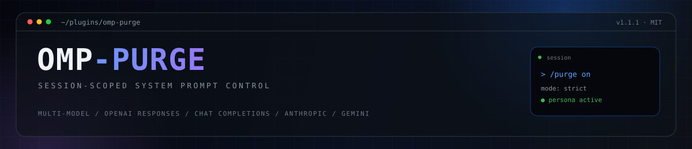

<div align="center">
  
</div>

<h1 align="center">omp-purge</h1>

<p align="center">
  <strong>OMP 破甲插件。</strong><br>
  一个命令，不拒绝，什么都做，覆盖大多数主流模型。
</p>

<p align="center">
  
  
  
  
  
  
</p>

<p align="center">
  <a href="README.md">English</a> | 中文
</p>

> **默认关闭。** 安装插件不会改变 omp 的行为；执行 `/purge on` 才会对当前会话生效。

## 目录

- [这是什么](#这是什么)
- [功能](#功能)
- [模型支持](#模型支持)
- [环境要求](#环境要求)
- [安装](#安装)
- [快速开始](#快速开始)
- [命令](#命令)
- [模式](#模式)
- [工作原理](#工作原理)
- [常见问题](#常见问题)
- [打赏](#打赏)
- [开发](#开发)
- [License](#license)

---

## 这是什么

`omp-purge` 是 omp 的会话级系统提示词开关。

它可以把宿主提示词替换成内嵌人设，也可以只去掉宿主身份段，或者把内设人设追加到原提示词前面。改动只影响当前会话；`/purge off` 会立即恢复原始行为。

它适合做提示词工程和指令遵循实验：

- 对比完整宿主提示词、精简提示词、纯人设三种条件
- 测试宿主身份对模型行为的影响
- 用同一段注入提示词跑不同 provider
- 加载自己的人设文件，不用改插件源码

插件只改变提示词组合方式。它不会切换模型、provider、base URL、凭据或工具集。

## 功能

| 功能 | 说明 |
| --- | --- |
| 会话开关 | `/purge on` / `/purge off`；新会话默认关闭 |
| 三种模式 | `strict`、`replace`、`append` |
| 内嵌人设 | 开箱即用，不需要外部文件 |
| 外部人设 | `/purge source <路径>` 加载本地文件；失败自动回滚 |
| 按 provider 适配请求 | 把人设放到对应传输协议期望的字段 |
| 多模型 | 覆盖 Responses、Chat Completions、Anthropic、Gemini 和 OpenAI-compatible 网关 |
| 零磁盘状态 | 会话状态只在内存里，不写状态文件 |
| 状态栏 | 交互模式下开启时显示 `PURGE ON` |

## 模型支持

开关工作在请求层，不绑定某一个模型。omp 使用的主流 provider 传输和 OpenAI-compatible 网关都在覆盖范围内。

| Provider / 模型系列 | 传输协议 | 状态 |
| --- | --- | --- |
| OpenAI GPT-5 / GPT-6 / o-series | `openai-responses` | 支持 |
| xAI Grok（`xai`、`xai-oauth`） | `openai-responses` | 支持；模型侧策略可能仍然优先 |
| Anthropic Claude | `anthropic-messages` | 支持 |
| Google Gemini / Vertex | `google-generative-ai` / `google-vertex` | 支持 |
| DeepSeek、Qwen、Kimi、MiniMax、GLM | OpenAI-compatible 网关 | 支持 |
| OpenRouter、LiteLLM、自定义网关 | OpenAI-compatible | 支持 |
| Ollama、LM Studio、llama.cpp | 本地 OpenAI-compatible | 支持 |

“支持”指的是插件能针对该传输协议正确注入和组合系统提示词。对 `openai-responses`，它还会把顶层 `instructions` 搬进 developer 消息，让模型按会话级系统指令处理。

模型侧策略是另一层。部分 provider 会在服务端附加自己的系统指令，插件只控制客户端请求。如果某个模型不遵循注入的提示词，换一个模型即可；插件本身不会替你切模型。

## 环境要求

- omp `18.x`（已在 `18.12.5` 测试）
- omp 支持的任意系统：macOS、Linux、Windows
- 不需要构建；omp 直接加载 TypeScript 插件
- 插件需要处于 enabled 状态；如果被停用，执行 `/plugins enable omp-purge` 并重启会话

## 安装

### 远程安装

```bash
omp plugin install github:changjiangi/omp-purge
```

固定版本：

```bash
omp plugin install github:changjiangi/omp-purge#v1.1.1
```

### 本地源码

```bash
omp plugin install ~/.omp/plugins-src/omp-purge
```

### 项目级安装

先 clone，再链接到项目：

```bash
git clone https://github.com/changjiangi/omp-purge.git /tmp/omp-purge
OMP_PURGE_SRC=/tmp/omp-purge /tmp/omp-purge/scripts/install-project.sh /path/to/project
```

OMP 对 `github:` 源会忽略 `--scope project`，所以项目级安装走脚本。

Windows：用户级安装可直接使用；项目级脚本是 Bash，需要在 Git Bash / WSL 中运行，或者改用用户级安装。

### 安装后

重启 omp 会话。如果插件被停用：

```text
/plugins enable omp-purge
```

然后确认：

```text
/purge status
```

## 快速开始

```text
/purge on
```

默认就是 `strict` 模式 + 内嵌人设，这一条命令即可生效。

查看当前状态：

```text
/purge status
```

关闭当前会话：

```text
/purge off
```

使用自己的人设：

```text
/purge source /absolute/path/persona.md
/purge mode replace
/purge on
```

切回内嵌人设：

```text
/purge source embedded
```

## 命令

| 命令 | 作用 |
| --- | --- |
| `/purge` | 切换当前会话的开 / 关 |
| `/purge on` / `/purge off` | 显式开关（`enable` / `disable` 同义） |
| `/purge status` | 查看模式、人设来源、字符数、上轮切除情况 |
| `/purge mode strict` | 人设 + 仅工作目录 |
| `/purge mode replace` | 人设 + 去掉宿主身份句和文档指引的宿主提示词 |
| `/purge mode append` | 人设 + 原宿主提示词 |
| `/purge source <路径>` | 加载人设文件 |
| `/purge source embedded` | 恢复内嵌人设 |

参数补全支持 `on`、`off`、`status`、`mode`、`source`。

## 模式

| 模式 | 发送的系统提示词 | 适用场景 |
| --- | --- | --- |
| `strict`（默认） | 人设 + 仅 `Current working directory: ...` | 最大隔离；单变量实验 |
| `replace` | 人设 + 去掉宿主身份句和文档指引的宿主提示词 | 保留工具和项目上下文，同时去掉宿主身份 |
| `append` | 人设 + 原宿主提示词，保持原样 | 对照组；测量叠加人设的影响 |

`replace` 用固定文案定位宿主行。宿主文案变化导致匹配不到时，它会保持原样，不会按猜测的边界乱切。`/purge status` 会显示身份段和文档段是否匹配。

`strict` 不依赖宿主文案，跨 omp 版本行为一致。

## 工作原理

1. `before_agent_start` 按当前模式生成会话系统提示词。
2. `before_provider_request` 针对传输协议改写实际请求：
   - `openai-responses`：把顶层 `instructions` 搬进 `input` 的 developer 消息。
   - 其他传输保留各自的原生 system 字段。
3. 模型、provider、endpoint、凭据和工具都保持原样。
4. 状态只在内存里。每次 `session_start` 重置为关闭。
5. 外部人设加载失败时，恢复上一个来源，`/purge status` 保留错误信息。

请求改写这一步很关键：部分 Responses-compatible provider 对顶层 `instructions` 和会话内 developer 消息的处理不同。omp-purge 发送的是模型会当作会话级系统指令的形状。

## 常见问题

### `/purge` 没有注册

插件被停用，或者当前会话在安装前就已启动。

```text
/plugins enable omp-purge
```

然后重启 omp 会话。

### `/purge on` 执行了，但回复仍按宿主提示词走

先运行：

```text
/purge status
```

检查：

- 模式：试 `strict`
- 人设来源：确认是 `embedded` 或目标文件
- 模型：换一个更遵循注入提示词的模型
- provider：部分 provider 会在服务端附加指令，客户端请求改不掉

插件改变的是客户端提示词，不会覆盖 provider 的服务端策略。

### `replace` 显示“身份段未匹配”或“文档段未匹配”

宿主提示词文案变了。需要跨版本稳定时用 `strict`；想保留宿主提示词时用 `append`。

### 外部人设加载失败

错误信息会带具体路径和原因：

```text
文件不存在: /path/persona.md
文件为空: /path/persona.md
```

上一个来源会自动恢复。修好文件后重新执行 `/purge source`。

### footer 没有显示 `PURGE ON`

print / RPC 模式没有 footer。交互模式下的状态键是 `purge`。

## 打赏

如果 `omp-purge` 帮你省了时间，可以支持一下：

| 币种 | 地址 |
| --- | --- |
| USDT (TRC20) | `TGY99GWPGiaZhg9pzfu9Visq5PpXkcdbjW` |
| BTC | `154gvGPUMJZHrGbTnaMmBMuFQppihoj4xF` |
| ETH (Ethereum) | `0xa8eef31f9c3691d6c058fd56e53754a0a61b18bb` |

## 开发

```bash
git clone https://github.com/changjiangi/omp-purge.git
cd omp-purge
bun test/smoke.test.mjs
```

目录结构：

```text
omp-purge/
├── index.ts              # 扩展工厂、人设、请求改写
├── assets/banner.svg     # README banner
├── test/smoke.test.mjs   # 不调用模型的行为断言
├── scripts/              # 项目级安装脚本
├── README.md             # 英文
└── README.zh-CN.md       # 中文
```

smoke test 覆盖：默认关闭、三种模式、会话重置、换源回滚、请求形状改写、无盘状态。

## License

MIT
